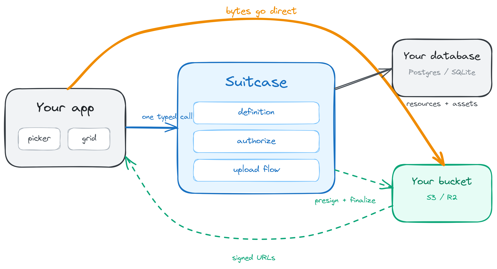

# Suitcase

Suitcase is a standalone, database- and storage-agnostic solution to handle user-generated-content (UGC),
providing a reusable architecture for uploads, storage, authorization, and validation.

Its core principles are extracted from the battletested SaaS [stratforge.gg](https://stratforge.gg), where it served
thousands of users monthly.

[](https://softzweig.github.io/suitcase/)
[](https://github.com/softzweig/suitcase/actions/workflows/ci.yml)
[](https://github.com/softzweig/suitcase/tags)
[](https://github.com/orgs/softzweig/packages?repo_name=suitcase)

> Disclaimer: this library was mostly hand-crafted in architecture, and large portions have been hand-written or scaffolded with AI and then were hand-rewritten to accommodate the overall style of the library. This was designed and executed by Vinzent Zeband (~bonrow). Most AI-assisted code was thoroughly reviewed, and important modules were initially extracted from Stratforge (the SaaS that was the first real-production prototype).

## Overall architecture

The architecture was human-made and designed behind following principles:

- **Separation of concerns:** Logical resources are independent of physical assets and their storage.
- **Asset deduplication:** SHA-256 content addressing prevents redundant storage and reduces costs.
- **Storage agnosticism:** Pluggable storage providers through a common abstraction.
- **Database agnosticism:** Repository interfaces decouple business logic from persistence implementations.
- **Secure uploads:** Presigned URLs, temporary uploads, and validated finalization.
- **Authorization:** Resource ownership and access control remain independent of storage providers.
- **Type safety:** Zod-backed resource definitions with TypeScript inference.
- **Modularity:** Independent packages for core logic, server services, adapters, and client integrations.



## Showcase

A resource kind is an owner plus its rules. This example models company invoices:

```ts
// Example only. These declarations live inside withResources().
const companyOwner = owner({
  schema: z.object({ companyId: z.string() }),
  authorize: async ({ execution, owner }) => {
    return isMemberOfCompany(execution.userId, owner.companyId);
  },
});

const companyInvoice = resource("companyInvoice", {
  bucket: "invoices",
  owner: companyOwner,
  read: read({
    claim: z.object({ companyId: z.string() }),
    verify: async ({ claim, execution }) => {
      if (!(await isMemberOfCompany(execution.userId, claim.companyId))) {
        throw ServiceError.forbidden("Not your company");
      }
      return claim;
    },
    expose: ({ requested, scope }) =>
      requested.filter(({ owner }) => owner.companyId === scope.companyId),
  }),
  upload: companyOwner.upload({
    mimeTypes: ["application/pdf"],
    maxSize: "10 MB",
    intent: z.object({ companyId: z.string(), folderId: z.string() }),
    ownedBy: ({ claims }) => ({ companyId: claims.intent.companyId }),
  }),
});
```

The client side is deliberately small:

```ts
// One typed call: limits, hashing, transfer, and finalize are handled for you.
await client.upload.start({
  kind: "companyInvoice",
  file,
  intent: { companyId: "c_1", folderId: "2026/q3" },
});
// That's it! Literally.
```

> **AI-transparency**: some parts were AI-_assisted_, AI-generated code was mostly
> reviewed line by line and confirmed for production-readyness. A large portion
> of code is scaffolded using AI but rewritten by hand, to match coding standards
> set by the organization. Also, a handful of components were copied from Stratforge
> into this library, but rewritten to follow the overall abstraction desired in Suitcase.

_The following sections are automatically backfilled and generated with AI to keep up to date with changes of the codebase._

## Documentation

The guides, concepts, package reference, and examples live in the docs site at
[softzweig.github.io/suitcase](https://softzweig.github.io/suitcase/).

```sh
pnpm docs:dev      # local docs server
pnpm docs:build    # static build in apps/docs/dist
pnpm docs:preview  # serve the static build under /suitcase
```

The site is an Astro Starlight app in `apps/docs`; content is Markdown/MDX under
`apps/docs/src/content/docs`. It uses `/suitcase` as its base path for GitHub Pages, so serve
`apps/docs/dist` with `pnpm docs:preview` rather than opening the files directly. Pushing to
`main` deploys it to GitHub Pages.

## Contributing

See [CONTRIBUTING.md](CONTRIBUTING.md) for setup, checks, changesets, and the pull request workflow.
Security issues must be reported privately as described in [SECURITY.md](SECURITY.md).

## Commands

| Command                 | Description                                  |
| ----------------------- | -------------------------------------------- |
| `pnpm install`          | Install all workspace dependencies           |
| `pnpm build`            | Build every package (Turborepo, cached)      |
| `pnpm test`             | Run all packages' tests in one Vitest run    |
| `pnpm test:watch`       | Vitest watch mode (all packages)             |
| `pnpm typecheck`        | Typecheck every package                      |
| `pnpm lint`             | Biome check across the repo                  |
| `pnpm check`            | Biome check + safe fixes                     |
| `pnpm format`           | Biome format + write                         |
| `pnpm docs:dev`         | Start the docs site locally                  |
| `pnpm docs:build`       | Build the docs site into `apps/docs/dist`    |
| `pnpm docs:preview`     | Serve the static docs build                  |
| `pnpm changeset`        | Record a release note (bump type) for a PR   |
| `pnpm version:packages` | Apply pending changesets (bump + changelogs) |
| `pnpm publish:packages` | Build, then publish unpublished versions     |

## Shared TypeScript configs

Each package extends one of the presets from `@softzweig/suitcase-typescript-config` (a
`workspace:*` dev dependency, never published):

| Preset               | Use                                              |
| -------------------- | ------------------------------------------------ |
| `base.json`          | Typecheck-only (no emit) strict baseline         |
| `library.json`       | Node ESM library emitting `dist/` + declarations |
| `react-library.json` | Same as `library.json` with React JSX + DOM libs |

```jsonc
// packages/<name>/tsconfig.build.json
{
  "extends": "@softzweig/suitcase-typescript-config/library.json",
  "include": ["src"],
  "compilerOptions": { "rootDir": "src", "outDir": "dist" }
}
```

Rule of thumb: `tsconfig.json` extends `base.json` and includes tests (typecheck), while
`tsconfig.build.json` extends the library preset and includes only `src` (emit).

## Testing

Vitest is installed and configured **globally**, like Biome — one root config, one command:

```ts
// vitest.config.ts
projects: ["packages/*", "!packages/typescript-config"];
```

Every package under `packages/` is its own Vitest project (named after its `package.json`
`name`), so a single `pnpm test` runs the whole repo while keeping per-package isolation:

| Command                                          | Description      |
| ------------------------------------------------ | ---------------- |
| `pnpm test`                                      | Run all projects |
| `pnpm test --project @softzweig/suitcase-sample` | Run one project  |
| `pnpm test:watch`                                | Watch mode       |

Tests live next to their package (`packages/<name>/test/**/*.test.ts`) and import the public
API from source (`../src/index.js`), so no build step is required. Add a config-only package to
the negation list in `vitest.config.ts` if it has no tests.

## Adding a package

1. Copy `packages/sample` to `packages/<name>` and rename to `@softzweig/suitcase-<name>`.
2. Keep `publishConfig.registry` pointed at GitHub Packages.
3. `pnpm install`.

## Versioning

Versions are managed by [Changesets](https://changesets.dev) — never edit a `version` by hand.

1. In your PR, run `pnpm changeset`, pick the packages and the bump type (`patch` / `minor` /
   `major`), and commit the generated `.changeset/*.md` file.
2. On every push to `main`, CI keeps a **Version Packages** PR up to date (`changeset version`):
   it bumps versions, writes `CHANGELOG.md`, and refreshes the lockfile.
3. **Merge that PR to release.** With no changesets left, CI publishes the bumped versions to
   GitHub Packages, creates the `@softzweig/suitcase-<pkg>@<version>` tags and GitHub releases.

Publishing is driven by committed versions only: while changesets are pending the job just
maintains the Version Packages PR, and once they are consumed it publishes whatever versions are
missing from the registry — so re-running a release is safe. A failed run is retried with
**Re-run failed jobs**, and any later push to `main` republishes anything outstanding. The private
`@softzweig/suitcase-typescript-config` is never versioned or published.

Changelogs use `@changesets/changelog-github`, so entries link the merged PR and credit its
author. It resolves the repo from `GITHUB_REPOSITORY` and calls the GitHub API with
`GITHUB_TOKEN` — both set automatically in Actions. For a local `pnpm version:packages`, provide
them yourself:

```bash
GITHUB_REPOSITORY=<owner>/suitcase GITHUB_TOKEN=<token> pnpm version:packages
```

> The release job needs _Settings → Actions → General → "Allow GitHub Actions to create and
> approve pull requests"_ enabled so it can open the Version Packages PR.

### Release model

**Merging the Version Packages PR is the release.** No separate promote step, tag push or
environment gate:

- push to `main` with pending changesets → the action opens/updates the Version Packages PR;
- merge that PR → the resulting `main` push has no changesets left, so the action publishes,
  creates the `@softzweig/suitcase-<pkg>@<version>` tags and a GitHub release per package;
- a failed run is retried from the Actions UI, and any later push to `main` republishes anything
  still missing from the registry.

Trade-off: merging that PR ships immediately. If you later want a second pair of eyes, add a
protected `environment` to the release job (gated to version-PR merges) instead of reintroducing
a release branch.

## Publishing

Packages are configured to publish to GitHub Packages as **public** packages, so the npm scope
(`@softzweig`) must match the GitHub owner (org or user) that owns this repository.

- `publishConfig` in each package sets `registry` and `access: public`.
- `.npmrc` routes `@softzweig/*` to `https://npm.pkg.github.com`.
- GitHub Packages defaults new packages to private. After the first public publish, confirm each
  package page is set to **Public**; changing visibility is irreversible.
- npm installs still require authentication, even for public GitHub Packages. Consumers need a
  token with `read:packages` in their `~/.npmrc`:

  ```
  @softzweig:registry=https://npm.pkg.github.com
  //npm.pkg.github.com/:_authToken=${GITHUB_TOKEN}
  ```

Existing package versions published before this change remain restricted; change their visibility
in each package's settings. After any release, verify that the new package version is public.

### CI/CD (`.github/workflows/ci.yml`)

- `verify` — runs on every push to `main` and on pull requests: install → lint → build →
  typecheck → test.
- `release` — runs on pushes to `main` once `verify` passes. With pending changesets it opens or
  updates the **Version Packages** PR; with none left it publishes via `pnpm publish:packages`
  (the same command as locally) and tags each released package. Needs `contents: write`,
  `pull-requests: write` and `packages: write`.

Both jobs cache the pnpm store (`setup-node`) and Turborepo's task cache (`.turbo/cache`), keyed
by commit with a `runner.os` fallback. Turbo keys every task by its inputs, so a stale hit is
never a correctness risk, and the same cache key means `release` replays the `build`/`typecheck`
work `verify` just did. `pnpm test` is a single global Vitest run, so Turbo has nothing to cache
for tests.

Git hooks are disabled in CI (`LEFTHOOK: "0"`). `changesets/action` commits and pushes with plain
`git commit` / `git push`, so installed hooks would otherwise fire during a release — and CI's
`pnpm lint` is deliberately read-only (`biome check`) where the hook runs `--write`.

## License

MIT, Copyright (c) 2026 Vinzent Zeband. See [LICENSE](LICENSE).
